# Testes Caixa Cinza em API de Autenticação — Supabase + Postman

> **Aluno:** Eduardo Moraes — **RA:** 251255 — **Turma:** N4
> **Data de execução dos testes:** 06/11/2026

## Sumário

1. [Introdução](#introdução)
2. [Objetivo da Atividade](#objetivo-da-atividade)
3. [Configuração do Supabase](#configuração-do-supabase)
4. [Configuração do Postman](#configuração-do-postman)
5. [Configuração das Requisições](#configuração-das-requisições)
6. [Execução dos Testes](#execução-dos-testes)
7. [Registro dos Testes](#registro-dos-testes)
8. [Resultados Obtidos](#resultados-obtidos)
9. [Conclusão](#conclusão)

### Estrutura do repositório

```
/README.md      → documentação completa da atividade
/postman/       → coleção e environment exportados do Postman
/prints/        → evidências (capturas de tela) produzidas durante a atividade
/planilha/      → planilha de registro dos testes
```

---

# Introdução

Testes de software verificam se um sistema se comporta como esperado em situações normais e em situações de erro. Em APIs de autenticação, isso é ainda mais importante: uma falha pode permitir que alguém entre sem credenciais válidas ou impedir que um usuário legítimo acesse o sistema.

Nesta atividade foi testado o serviço de autenticação do **Supabase** (Supabase Auth), uma plataforma que oferece banco de dados PostgreSQL, autenticação e APIs prontas. Os testes foram feitos com o **Postman Desktop**, ferramenta que permite montar, enviar e validar requisições HTTP.

A abordagem utilizada foi a de **teste caixa cinza**. No teste caixa preta, o testador conhece apenas entradas e saídas; no caixa branca, conhece o código-fonte. No caixa cinza, o testador tem **conhecimento parcial** da estrutura: neste caso, eu conhecia o endpoint, o método HTTP, os headers obrigatórios, o formato do body JSON e os possíveis códigos de resposta, mas não o código interno do serviço de autenticação. Esse conhecimento permitiu planejar cenários mais precisos, como o envio de requisições sem a chave de API ou com campos vazios.

# Objetivo da Atividade

Compreender e aplicar testes caixa cinza em uma API de autenticação, sendo capaz de:

- configurar um ambiente de autenticação por e-mail e senha no Supabase;
- criar um usuário para testes;
- entender a estrutura de uma requisição HTTP (método, URL, headers e body);
- configurar workspace, environment, variáveis e requisições no Postman;
- executar cenários de sucesso e de erro e validar status HTTP, respostas JSON, mensagens de erro e o access token;
- registrar e documentar tecnicamente todo o processo.

# Configuração do Supabase

### Criação do projeto

1. Acessei [supabase.com](https://supabase.com) com a minha conta, vinculada à organização **dxduzinnn's Org** (plano Free).
2. No painel, cliquei em **New project**, escolhi a organização, defini o nome **testes-auth-Eduardo**, uma senha para o banco de dados e a região **East US (North Virginia) – us-east-1**.
3. Aguardei o provisionamento do projeto até o painel ficar disponível.

### Tipo de autenticação

Foi utilizada a autenticação por **e-mail e senha** (provider *Email*), em **Authentication → Sign In / Providers → Email**, que já vem habilitada por padrão. Esse é o tipo de autenticação usado pelo endpoint `/auth/v1/token?grant_type=password`, em que o cliente envia e-mail e senha e recebe um token de acesso.

A opção *Confirm email* ficou **ligada** (padrão). Por isso, o usuário de teste foi criado com **Auto Confirm User**: sem isso, o login retornaria erro de e-mail não confirmado. A opção *Allow new users to sign up* também está ligada.

### Criação do usuário de teste

Em **Authentication → Users → Add user → Create new user**, criei o usuário **teste.eduardo@exemplo.com** com uma senha definida por mim, marcando a opção **Auto Confirm User**, para que o usuário já ficasse confirmado e pudesse fazer login sem precisar confirmar o e-mail.

### Credenciais da API

Em **Project Settings → API Keys** (e **Data API** para a URL), obtive:

| Informação | Onde encontrar | Uso nos testes |
|---|---|---|
| API URL (Project URL) | Project Settings → Data API | Base da URL das requisições (`base_url`) |
| API KEY (publishable: `sb_publishable_...`) | Project Settings → API Keys | Headers `apikey` e `Authorization` (`api_key`) |

> **Segurança:** foi usada apenas a chave **pública** (anon/publishable), que é feita para uso em clientes. A chave **service_role/secret** nunca foi usada nem exposta, pois ignora as regras de segurança do banco. A senha do usuário de teste não está publicada neste repositório.

### Objetivo da configuração

Criar um ambiente de autenticação real e controlado, com um usuário conhecido, para que fosse possível comparar o comportamento da API com credenciais corretas e incorretas.

### Evidências

| Evidência | Print |
|---|---|
| Projeto criado | 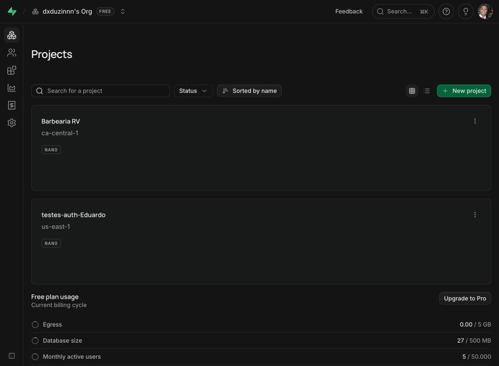 |
| Painel do Supabase | 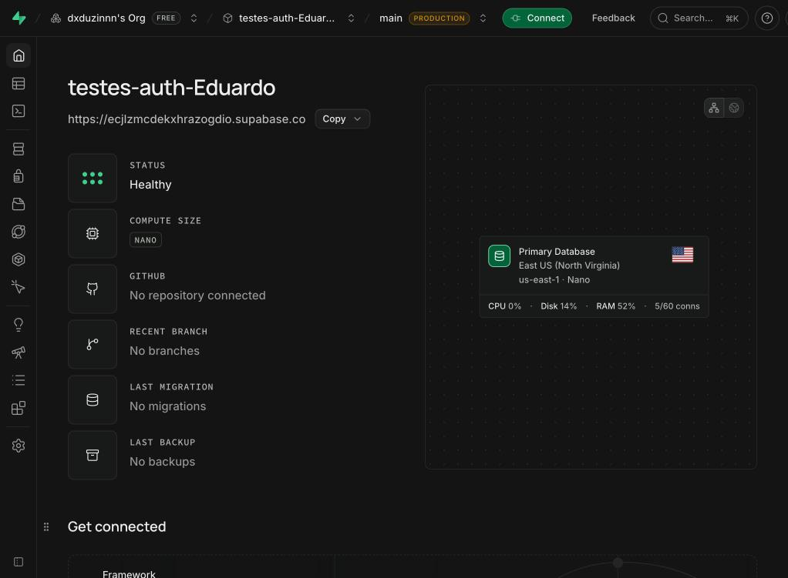 |
| Autenticação por e-mail habilitada | 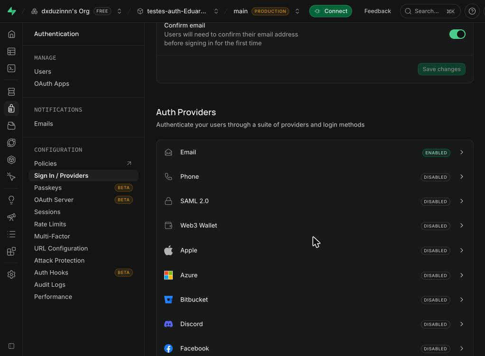 |
| Usuário criado | 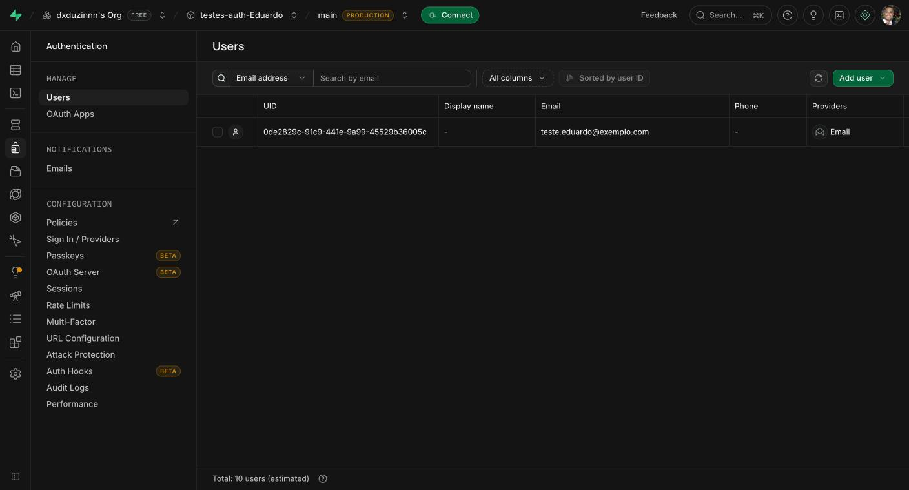 |
| Credenciais da API | 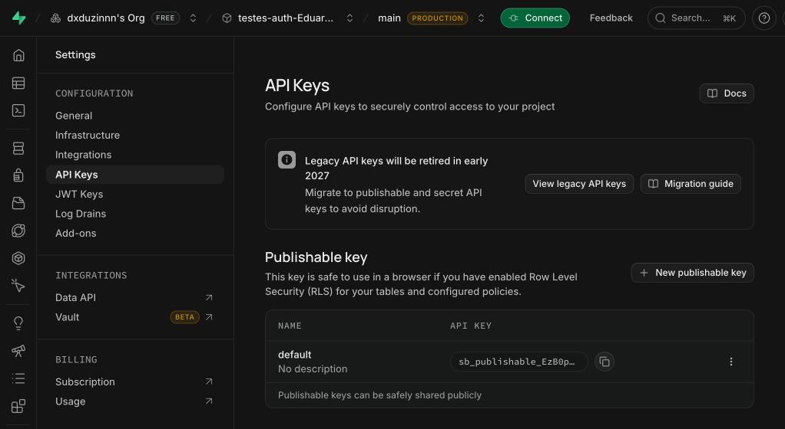 |
| Identificação do aluno no ambiente | 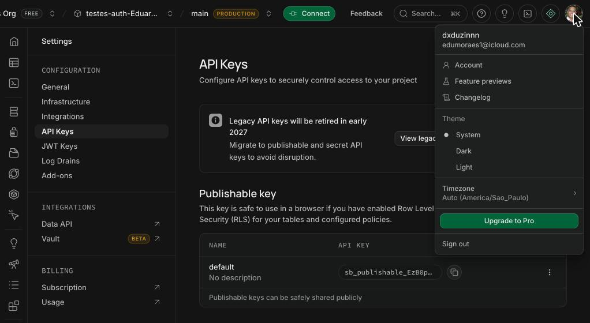 |

# Configuração do Postman

### Workspace

No Postman Desktop, em **Workspaces → Create**, criei o workspace **Testes Caixa Cinza - Eduardo** (opção *Blank workspace*) para concentrar todos os artefatos da atividade. Em seguida, usei **File → Import** para importar a coleção e o environment que estão na pasta [`/postman`](postman/).

### Environment

O environment **Supabase - Testes Auth** foi importado, preenchido com a URL do projeto (`https://ecjlzmcdekxhrazogdio.supabase.co`), o e-mail do usuário de teste, a chave pública e a senha, e selecionado no canto superior direito. Um environment guarda valores que mudam de um ambiente para outro (URL, chaves, usuários), evitando digitá-los em cada requisição.

| Variável | Descrição | Tipo |
|---|---|---|
| `base_url` | URL da API do Supabase (ex.: `https://xxxx.supabase.co`) | default |
| `api_key` | API KEY pública do projeto | secret |
| `email` | E-mail do usuário criado | default |
| `password` | Senha do usuário criado | secret |
| `access_token` | Preenchida automaticamente pelo teste CT01 | secret |

### Finalidade das variáveis

As variáveis são usadas com a sintaxe `{{nome}}`. Assim, as requisições não têm dados sensíveis escritos diretamente nelas, ficam reutilizáveis (basta trocar o environment para testar outro projeto) e um mesmo valor é alterado em um único lugar. O tipo *secret* oculta o valor na tela.

### Como o Postman foi utilizado

Criei a coleção **Testes Caixa Cinza - Supabase Auth**, com uma requisição por cenário. Cada requisição tem, na aba **Scripts → Post-response**, testes automáticos (`pm.test`) que validam o status HTTP, a presença ou ausência do `access_token` e a mensagem de erro. A coleção foi executada individualmente e também pelo **Collection Runner**. A coleção e o environment exportados estão em [`/postman`](postman/) (o environment foi exportado **sem** a chave e a senha).

### Evidências

| Evidência | Print |
|---|---|
| Workspace criado | 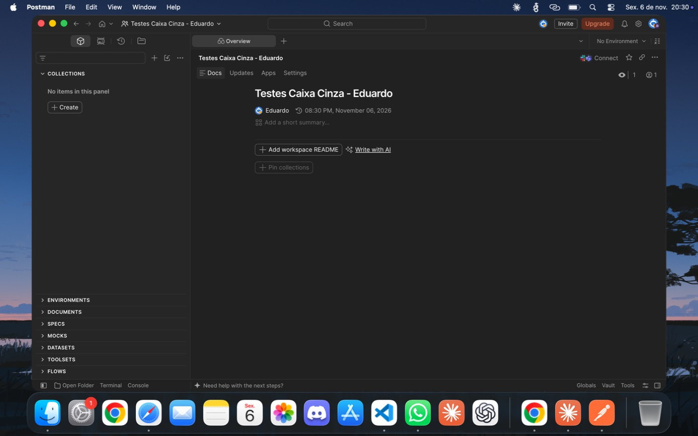 |
| Environment criado | 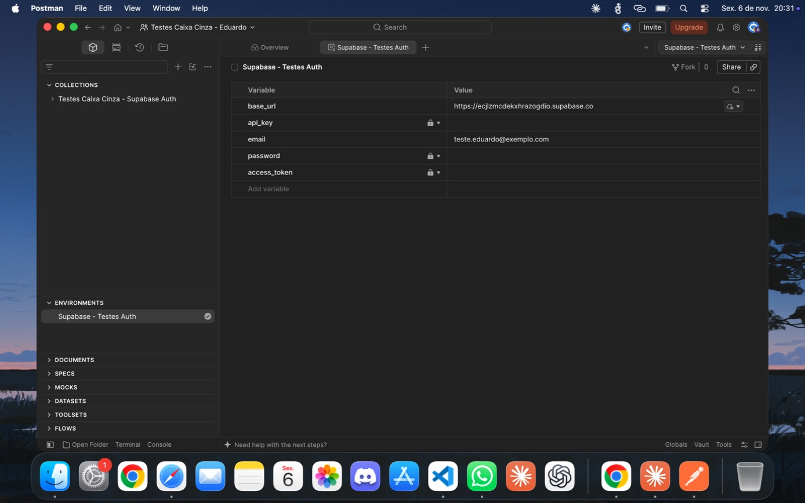 |
| Variáveis configuradas | 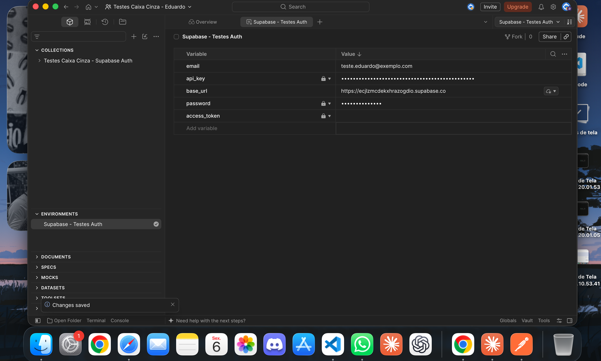 |
| Organização do Postman (coleção) | 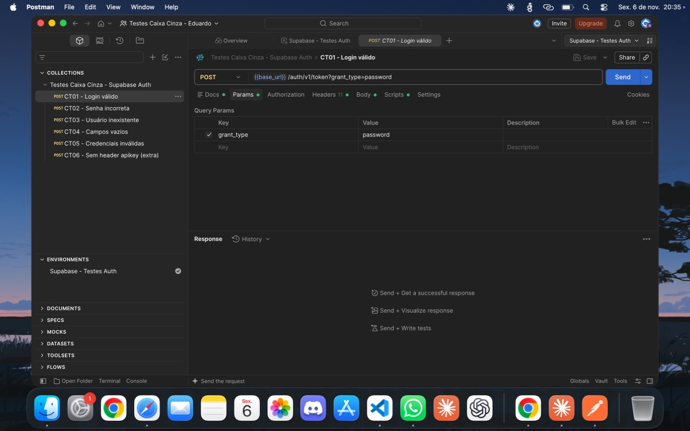 |

# Configuração das Requisições

| Item | Valor |
|---|---|
| Endpoint | `{{base_url}}/auth/v1/token?grant_type=password` |
| Método HTTP | `POST` |
| Parâmetro de query | `grant_type=password` (login com e-mail e senha) |
| Finalidade | Autenticar o usuário e obter um `access_token` (JWT) |

O método **POST** é usado porque as credenciais são enviadas no corpo da requisição, e não na URL, onde poderiam ficar registradas em históricos e logs.

### Exemplo de Header

| Header | Valor | Função |
|---|---|---|
| `apikey` | `{{api_key}}` (XXXXX) | Identifica o projeto Supabase; sem ela a requisição é rejeitada |
| `Authorization` | `Bearer {{api_key}}` | Envia a chave no formato Bearer |
| `Content-Type` | `application/json` | Informa que o body está em JSON |

### Exemplo do Body JSON

```json
{
  "email": "usuario@email.com",
  "password": "123456"
}
```

Na coleção, o body do login válido usa as variáveis:

```json
{
  "email": "{{email}}",
  "password": "{{password}}"
}
```

### Exemplo de resposta de sucesso (estrutura)

```json
{
  "access_token": "eyJhbGciOi...",
  "token_type": "bearer",
  "expires_in": 3600,
  "expires_at": 1700000000,
  "refresh_token": "...",
  "user": { "id": "...", "email": "...", "role": "authenticated" }
}
```

### Evidências

| Evidência | Print |
|---|---|
| Endpoint configurado |  |
| Headers | 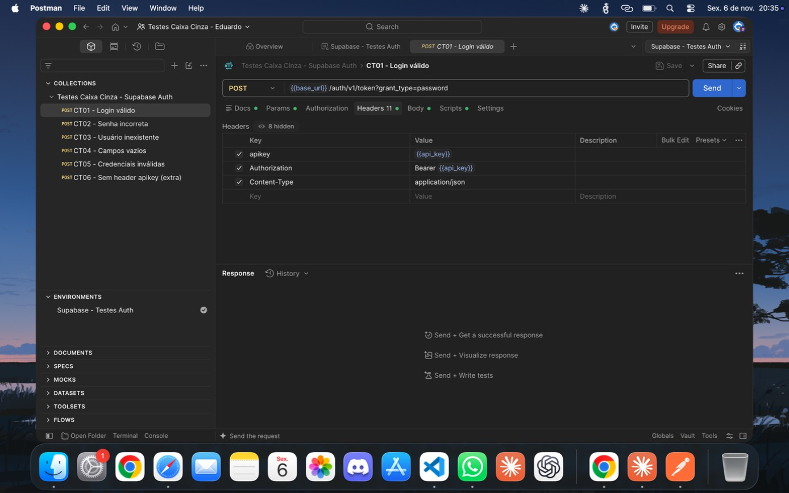 |
| Body JSON |  |
| Requisição criada no Postman | 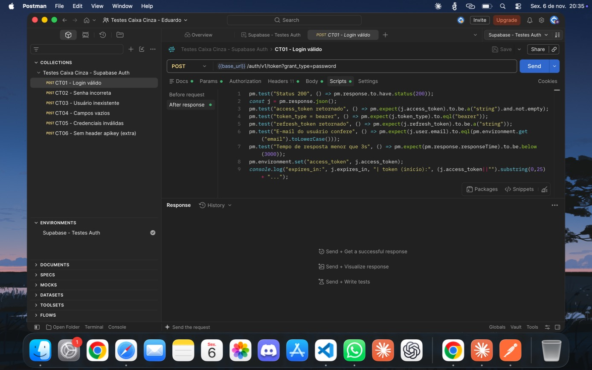 |

# Execução dos Testes

### Cenários executados

Foram executados os cinco cenários obrigatórios e um cenário extra (CT06), planejado a partir do conhecimento parcial da API (característica do teste caixa cinza): o que acontece se a requisição estiver correta, mas sem a chave de API.

Em cada execução foram validados: **status HTTP**, **resposta JSON**, **mensagem de erro**, **presença/ausência do access token** e **comportamento da autenticação**.

### Tabela de Cenários

| Cenário | Entrada Utilizada | Resultado Esperado | Resultado Obtido | Status |
|---|---|---|---|---|
| CT01 – Login válido | Usuário correto + senha correta | Status 200 + access token | **200 OK** (1,82 s), `access_token` JWT, `token_type: bearer`, `expires_in: 3600` | OK |
| CT02 – Senha incorreta | Usuário correto + `SenhaErrada!999` | Erro de autenticação, sem token | **400 Bad Request** (607 ms), `invalid_credentials` – "Invalid login credentials" | OK |
| CT03 – Usuário inexistente | `usuario.inexistente.teste@exemplo.com` | Acesso negado, sem token | **400 Bad Request** (533 ms), `invalid_credentials` – "Invalid login credentials" | OK |
| CT04 – Campos vazios | `email: ""`, `password: ""` | Erro de validação | **400 Bad Request** (469 ms), `validation_failed` – "missing email or phone" | OK |
| CT05 – Credenciais inválidas | `email-sem-arroba` + `123` | Mensagem de erro | **400 Bad Request** (536 ms), `invalid_credentials` – "Invalid login credentials" | OK |
| CT06 – Sem apikey (extra) | Credenciais corretas, sem headers de chave | Status 401 | **401 Unauthorized** (79 ms), "No API key found in request" | OK |

### Respostas observadas

**CT01 – Login válido (200 OK)** — resposta resumida (token encurtado):

```json
{
  "access_token": "eyJhbGciOiJFUzI1NiIsImtpZCI6...",
  "token_type": "bearer",
  "expires_in": 3600,
  "expires_at": 1794011750,
  "refresh_token": "...",
  "user": { "email": "teste.eduardo@exemplo.com", "role": "authenticated" }
}
```

**CT02 – Senha incorreta** e **CT03 – Usuário inexistente** (400 Bad Request):

```json
{
  "code": 400,
  "error_code": "invalid_credentials",
  "msg": "Invalid login credentials"
}
```

**CT04 – Campos vazios** (400 Bad Request):

```json
{
  "code": 400,
  "error_code": "validation_failed",
  "msg": "missing email or phone"
}
```

**CT05 – Credenciais inválidas** (400 Bad Request): mesma resposta do CT02 (`invalid_credentials`).

**CT06 – Sem apikey** (401 Unauthorized):

```json
{
  "message": "No API key found in request",
  "hint": "No `apikey` request header or url param was found."
}
```

### Erros encontrados

Todos os cenários tiveram o comportamento esperado: o login válido gerou token e nenhum cenário inválido devolveu `access_token`. As observações relevantes foram:

- **CT02 e CT03 retornaram exatamente a mesma resposta.** Isso é desejável: a API não revela se o e-mail existe, o que impede a enumeração de usuários.
- **CT04:** a mensagem "missing email or phone" cita apenas o e-mail/telefone e não informa que a senha também estava vazia.
- **CT05:** a API **não valida o formato do e-mail** no login. Um e-mail sem `@` é tratado como credencial inválida (`invalid_credentials`), e não como erro de validação. Não é uma falha de segurança, mas a mensagem poderia ser mais específica.
- **CT06:** a requisição sem `apikey` é barrada no gateway em 79 ms, antes de chegar ao serviço de autenticação.
- O assistente do Postman sugeriu remover o header `Authorization`, porque a chave publishable (`sb_publishable_...`) não é um JWT. Mesmo assim, todas as requisições funcionaram com o header presente.

### Evidências

| Evidência | Print |
|---|---|
| CT01 – login válido (status 200 + access token) | 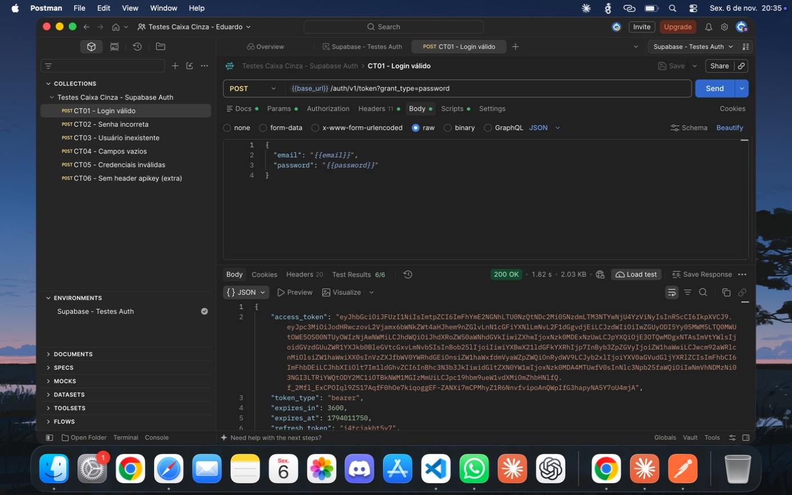 |
| CT02 – senha incorreta |  |
| CT03 – usuário inexistente |  |
| CT04 – campos vazios | 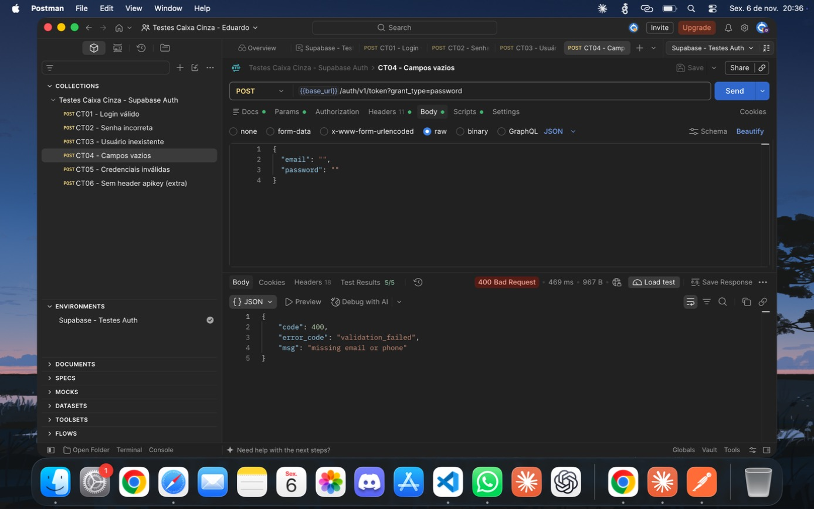 |
| CT05 – credenciais inválidas |  |
| CT06 – sem apikey |  |
| Aba Test Results (testes automáticos) | 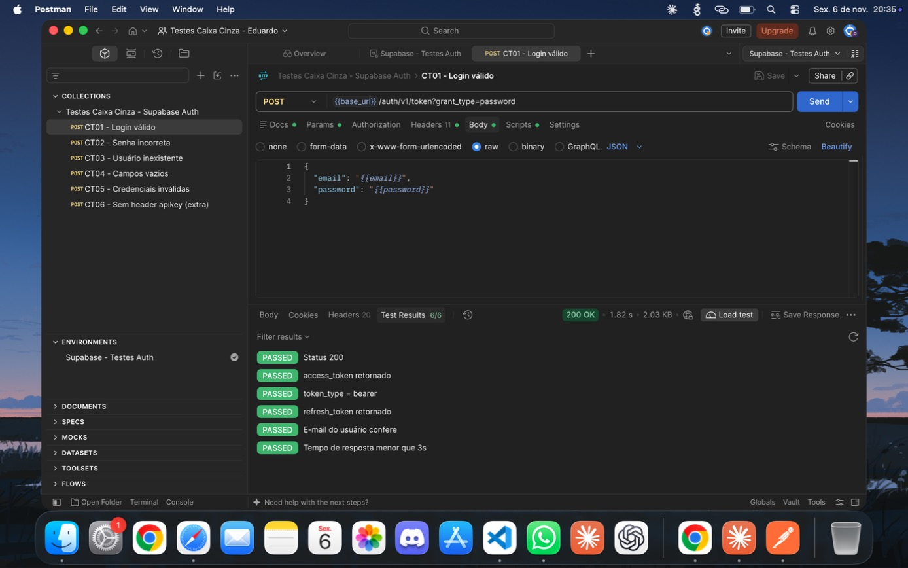 |
| Collection Runner | 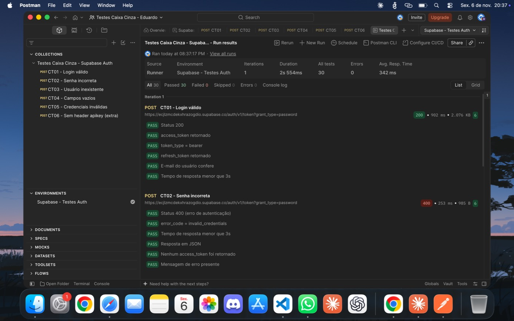 |

# Registro dos Testes

### Como os testes foram registrados

Cada execução foi registrada na planilha [`planilha/Planilha_Testes_Caixa_Cinza.xlsx`](planilha/), com os campos:

| Campo | Descrição |
|---|---|
| ID do teste | Identificação (CT01 a CT06) |
| Cenário | Descrição do caso |
| Entrada | Dados utilizados |
| Resultado esperado | Resultado correto previsto antes da execução |
| Resultado obtido | Resultado real (status HTTP + trecho da resposta) |
| Status | Sucesso / Falha |
| Observações | Comentários |

O resultado esperado foi preenchido **antes** da execução e o resultado obtido **depois**, com base no que o Postman mostrou, para que a comparação fosse honesta.

### Importância da documentação dos testes

A documentação permite repetir os testes (reprodutibilidade), comprovar o que foi testado (evidência), comparar resultados entre versões do sistema (regressão) e comunicar falhas à equipe de desenvolvimento com dados objetivos: entrada, resultado esperado e resultado obtido.

### Falhas identificadas

Nenhum teste ficou com status *Falha*: os 6 cenários tiveram o comportamento obtido igual ao esperado, e as 30 verificações automáticas do Postman passaram. Foram registradas, como observações, duas mensagens que poderiam ser mais específicas: a de campos vazios (CT04), que não menciona a senha, e a de e-mail em formato inválido (CT05), que é tratada como credencial inválida.

### Evidências

| Evidência | Print |
|---|---|
| Planilha preenchida | 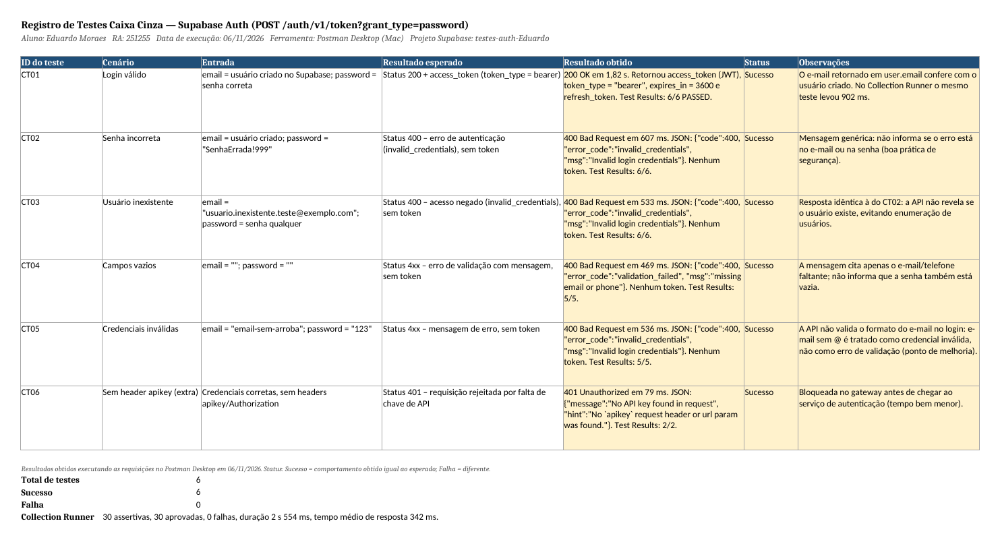 |

Exemplo de registro realizado:

| ID | Cenário | Entrada | Resultado esperado | Resultado obtido | Status | Observações |
|---|---|---|---|---|---|---|
| CT01 | Login válido | e-mail e senha corretos | 200 + access_token | 200 OK em 1,82 s, access_token retornado, 6/6 testes | Sucesso | user.email confere com o usuário criado |
| CT02 | Senha incorreta | senha `SenhaErrada!999` | Erro, sem token | 400, `invalid_credentials`, 6/6 testes | Sucesso | Mensagem genérica, não revela se o erro é no e-mail ou na senha |
| CT05 | Credenciais inválidas | `email-sem-arroba` + `123` | Mensagem de erro, sem token | 400, `invalid_credentials`, 5/5 testes | Sucesso | Formato do e-mail não é validado no login |

# Resultados Obtidos

Execução individual de cada requisição e execução completa pelo **Collection Runner** em 06/11/2026:

| Total de cenários | Sucesso | Falha | Assertivas no Runner | Duração do Runner | Tempo médio de resposta |
|---|---|---|---|---|---|
| 6 | 6 | 0 | 30 de 30 aprovadas | 2 s 554 ms | 342 ms |

O login válido (CT01) retornou **status 200** com `access_token`, `refresh_token`, `token_type: bearer` e validade de 3600 segundos (1 hora). Todos os cenários inválidos foram bloqueados sem devolver token: senha incorreta, usuário inexistente, campos vazios e credenciais inválidas retornaram **400 Bad Request**, e a requisição sem chave de API retornou **401 Unauthorized**. Os tempos de resposta ficaram entre 79 ms e 1,82 s, todos abaixo do limite de 3 s definido nos testes.

# Conclusão

**Os testes foram executados corretamente?** Sim. Os cinco cenários obrigatórios e o cenário extra foram executados no Postman Desktop, primeiro individualmente e depois pelo Collection Runner, que aprovou as 30 verificações automáticas sem nenhuma falha.

**A autenticação funcionou?** Sim. Com credenciais corretas, o Supabase devolveu status 200 e um `access_token` válido por 1 hora. Em todos os cenários inválidos o acesso foi negado e nenhum token foi gerado.

**Quais dificuldades encontrei?** A primeira foi localizar as credenciais: o Supabase agora separa a chave **publishable** (pública, usada nos testes) da **secret** (privada, que não pode ser exposta). Também foi preciso marcar **Auto Confirm User** ao criar o usuário, porque a confirmação de e-mail está ligada no projeto. Por fim, a configuração do Environment exigiu atenção para não colocar a URL com barra no final e para salvar as variáveis antes de enviar as requisições.

**Quais falhas foram identificadas?** Nenhuma falha de segurança: a API não gera token com credenciais erradas e responde da mesma forma para senha incorreta e usuário inexistente, evitando a enumeração de usuários. Foram observados dois pontos de melhoria nas mensagens: com campos vazios, a resposta cita apenas o e-mail (`missing email or phone`), e um e-mail em formato inválido é tratado como credencial inválida, sem uma validação de formato específica.

**Quais melhorias poderiam ser implementadas?** Mensagens de validação mais específicas para campos vazios e e-mail malformado; limite de tentativas de login com bloqueio temporário (o Supabase oferece configurações de *Rate Limits* e *Attack Protection*, como CAPTCHA); exigência de senha forte; autenticação em dois fatores; e a automação destes testes com o **Newman** ou o **Postman CLI** em um pipeline de integração contínua, para que eles rodem a cada alteração.

**Qual a importância dos testes caixa cinza em APIs?** Conhecer parte da estrutura da API — o endpoint, os headers obrigatórios, o formato do body e os códigos de resposta — permitiu planejar testes mais direcionados do que no caixa preta, como o CT06, que remove a `apikey` para verificar se a proteção do gateway funciona, ou o CT04, que testa a validação de campos vazios. Ao mesmo tempo, sem depender do código-fonte, o teste se aproxima do que um cliente real ou um atacante faria, ajudando a encontrar problemas de segurança e de usabilidade antes que cheguem à produção.
